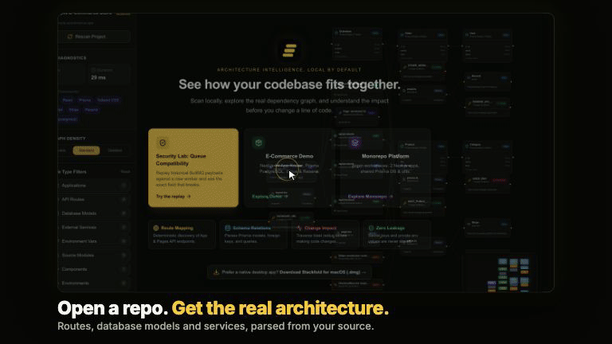
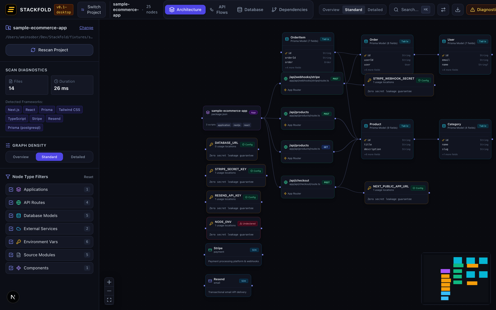
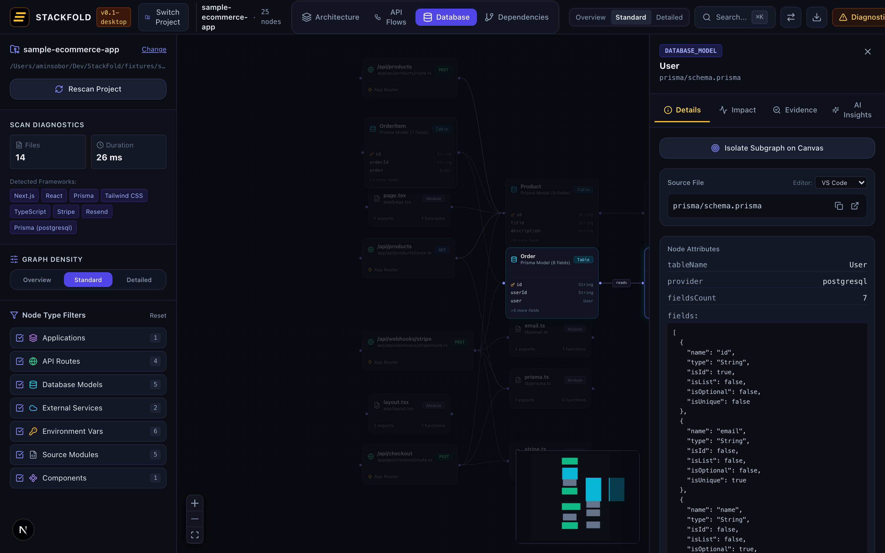

<div align="center">


# Stackfold

**See what a change will break, before you ship it.**

Map your JavaScript and TypeScript codebase, trace what depends on what, and replay historical data against new code to find the exact field, byte, or session that breaks.

[](https://stack-fold-web.vercel.app)
[](https://github.com/AminSS99/StackFold/actions/workflows/ci.yml)
[](https://github.com/AminSS99/StackFold/releases)
[](LICENSE)

**[Open Live Website & Interactive Studio](https://stack-fold-web.vercel.app)** · **[Watch 50-Second Walkthrough on the Website](https://stack-fold-web.vercel.app/download#walkthrough)** · **[Download macOS Alpha (`v0.1.0`)](https://github.com/AminSS99/StackFold/releases/tag/v0.1.0)**

<a href="https://stack-fold-web.vercel.app/download#walkthrough"></a>

<sub>The live website at <a href="https://stack-fold-web.vercel.app"><strong>stack-fold-web.vercel.app</strong></a> features the full 50-second interactive walkthrough video with clickable scene chapters (<a href="docs/media/stackfold-demo.mp4">raw MP4 in repo</a>) alongside the live interactive graph studio and Security Lab.</sub>

</div>

---

## See How Stackfold Works (Live Website)

You can see how Stackfold works right in your browser—no installation required—at **[https://stack-fold-web.vercel.app](https://stack-fold-web.vercel.app)**:

- **[Interactive 50-Second Walkthrough](https://stack-fold-web.vercel.app/download#walkthrough)** — Embedded directly on both the home studio ([`/`](https://stack-fold-web.vercel.app)) and the product overview page ([`/download`](https://stack-fold-web.vercel.app/download#walkthrough)). It auto-plays as you scroll and includes **5 clickable chapter markers** (`01 Architecture map` · `02 Blast radius` · `03 Queue replay` · `04 Security probes` · `05 CI gate`) captured frame-for-frame from the real app.
- **[Live Architecture Studio](https://stack-fold-web.vercel.app)** — Click **E-Commerce Demo** or **Monorepo Platform** (or open the project switcher to try **PreviewFence**, **TxEscape**, and **ScopePatch + IDTrace**) to explore the live Dagre dependency graph across four lenses (*Architecture*, *API Flow*, *Database*, *Dependencies*), inspect AST file/line evidence, and traverse downstream change blast radius.
- **[Security Lab (`Queue`, `Signature`, `Cache`)](https://stack-fold-web.vercel.app/security-lab/queue)** — Step through historical BullMQ payload replay ([`/security-lab/queue`](https://stack-fold-web.vercel.app/security-lab/queue)), HMAC-SHA256 canonicalization byte-diffing ([`/security-lab/signature`](https://stack-fold-web.vercel.app/security-lab/signature)), and two-session authenticated cache-isolation probes ([`/security-lab`](https://stack-fold-web.vercel.app/security-lab)).

---

## The Problem

Tests pass and CI is green—then a queue worker rejects yesterday's jobs, a webhook signature stops verifying, or one user sees another user's cached page. Those failures live *between* pieces of code and between versions of data, which is where unit tests rarely look.

Stackfold is built for that gap. It parses your source code deterministically (no LLM guessing), maps how your system fits together, and *tests the seams*.

## What It Does

| Capability | How It Works |
| :--- | :--- |
| **Architecture Map** | Scans a repository into an interactive graph of applications, API routes, database models, external services, environment variables, and workspace package dependencies. Every node and edge links back to an exact file path, line/column range, code snippet, and detector rule. |
| **Blast Radius** | Select any file, route, or model to trace its direct and transitive dependents. In the bundled e-commerce demo, selecting `lib/prisma.ts` immediately surfaces the 3 API endpoints and downstream modules that depend on it. |
| **Queue Compatibility** | Replays historical BullMQ payloads against the current worker contract, fully offline with no live Redis required. Validated against Misskey's real `userWebhookDeliver` queue (6/6 verdicts match actual worker behavior). Reports the exact failing field and validation step—for example, `customer.email` at `check-required-fields`. |
| **Signature Compatibility** | Runs the webhook/request signer and verifier side by side across normalization test vectors and pinpoints the first differing byte, complete with a copy-pasteable reproduction snippet. |
| **Cache Isolation** | Drives two authenticated Playwright browser sessions to prove whether private user data crosses a shared HTTP/HTML cache key, and generates the standalone Playwright regression test. |
| **Architecture Guardrails & CI Gate** | `--fail-on-findings` exits non-zero on confirmed findings with `terminal`, `json`, `github-actions`, and `circleci` reporters. Includes detectors for emails/webhooks/jobs fired inside database transactions (**TxEscape**), preview deployments bound to production Supabase projects (**PreviewFence**), upstream symbol drift (**Drift Impact**), GitHub App REST permission gaps (**ScopePatch**), and untyped identity-domain crossings (**IDTrace**). |

<table>
<tr>
<td width="50%"><br /><sub>Architecture map with deterministic Dagre layout</sub></td>
<td width="50%"><br /><sub>Node inspector with AST source evidence and blast radius</sub></td>
</tr>
</table>

---

## Try It in a Minute

**1. In your browser (zero install):**
Open **[https://stack-fold-web.vercel.app](https://stack-fold-web.vercel.app)** to watch the 50-second walkthrough video, click through pre-bundled example projects, and test the Security Lab in real time.

**2. From source** (requires Node 20+ and pnpm 10+):

```bash
pnpm install --frozen-lockfile
pnpm --filter=@stackfold/scanner... build

# A confirmed finding: an email sent inside a Prisma database transaction. Exits 1.
packages/scanner/dist/stackfold.cjs fixtures/tx-escape-prisma --format terminal --fail-on-findings

# Replay historical BullMQ queue payloads against a v2 worker contract. Exits 1 on the failing fixture.
packages/scanner/dist/stackfold.cjs queue-compatibility fixtures/queue-compatibility-failing --out result.json

# Launch the interactive Web Studio locally (http://localhost:3000)
pnpm dev:web
```

---

## How It Is Built

- **Deterministic by design.** Powered by the TypeScript compiler AST and schema parsers—zero LLM guessing in the analysis loop. Every finding carries source-coordinate evidence and is explicitly classified as *confirmed* or *uncertain*.
- **Local-first.** Repository analysis runs locally on your machine, and ordinary scans exclude active `.env` files by default.
- **One engine, three surfaces.** A single `@stackfold/scanner` engine powers the Tauri 2 native macOS desktop app, the Node.js CLI, and the Next.js web studio through a typed platform-adapter layer (`@stackfold/platform`; see [ARCHITECTURE.md](ARCHITECTURE.md)).
- **Verified claims.** Support is claimed only where automated tests verify it: 75+ automated tests across `@stackfold/scanner`, `@stackfold/graph`, `@stackfold/platform`, and the Rust Tauri backend, plus a self-scan regression test and real-application validation.

---

## Current Supported Ecosystem

Stackfold analyzes real codebases using deterministic AST and schema parsing. Support is verified against the following technologies:

| Category | Verified Technologies |
| :--- | :--- |
| **Languages** | TypeScript (`.ts`, `.tsx`), JavaScript (`.js`, `.jsx`, `.mjs`, `.cjs`) |
| **Frameworks** | Next.js 13/14/15 (App Router routes & Pages Router API endpoints) |
| **Databases & ORMs** | Prisma (`schema.prisma` models, scalar fields, relations, enums, `$transaction` boundaries) |
| **Monorepo Tools** | pnpm workspaces (`pnpm-workspace.yaml`), Lerna (`lerna.json`) |
| **External Services** | Stripe, Resend, Supabase client initializations, GitHub App / Octokit REST permissions |
| **Seam & Compatibility Labs** | BullMQ offline payload replay, HMAC-SHA256 signature canonicalization checks, Playwright two-session cache isolation probes |
| **Environment Configs** | `.env.example`, `process.env.*`, `import.meta.env.*` reference sites, Vercel environment bindings |

*(Note: We only claim support for technologies covered by automated test suites. See [ROADMAP.md](ROADMAP.md) for upcoming framework support.)*

---

## Security & Privacy Model

Stackfold is built around a strict local-first security boundary:

1. **Local Analysis**: Local-mode scanning keeps analysis on your machine. Optional cloud saving/sharing in configured web deployments sends the selected graph, including its evidence, to the configured backend; review it before sharing private repositories. Explicit live probes also contact their configured test targets.
2. **Secret Handling**: Active environment files (`.env`, `.env.local`, `.env.production`) are excluded by default. Scans extract environment-reference names only. Configured live probes use synthetic test credentials; recorded probe results redact credential and payload values.
3. **Path Traversal & System Root Defense**: The desktop application canonicalizes paths and rejects system root directories (`/`, `/System`, `/private`, `/etc`, `/var`, `/usr`, `C:\Windows`) with `FORBIDDEN_SYSTEM_ROOT`.
4. **Sandboxed Webview**: The desktop shell enforces an active Content Security Policy (CSP) with typed Tauri IPC invoke barriers.
5. **Clean Process Lifecycle**: Scanner sidecars are managed with atomic PID tracking to terminate child processes cleanly on cancellation or window exit.

For full details, read our [SECURITY.md](SECURITY.md).

---

## Installation & Running

### Web Studio (Hosted)

Visit **[https://stack-fold-web.vercel.app](https://stack-fold-web.vercel.app)** to watch the walkthrough and explore the bundled repositories and Security Lab in your browser, or **[https://stack-fold-web.vercel.app/download](https://stack-fold-web.vercel.app/download)** for the product overview and macOS download details.

### Desktop Application (macOS Apple Silicon)

1. Install Node.js 20 or later, then download `Stackfold_0.1.0_aarch64.dmg` from the [v0.1.0 release](https://github.com/AminSS99/StackFold/releases/tag/v0.1.0) (or via the [download page](https://stack-fold-web.vercel.app/download)). This is an Apple Silicon early-alpha build; the newer Security Lab modules are available on the [live website](https://stack-fold-web.vercel.app) and in source checkouts until the next desktop release is cut.
2. Open the disk image and drag `Stackfold.app` into your `/Applications` folder.
3. **Gatekeeper Notice (Early Alpha):** Because this early alpha release is not yet notarized by Apple, macOS Gatekeeper may present a security warning on first open. To open:
   ```bash
   xattr -cr /Applications/Stackfold.app
   ```
   *Alternatively, right-click `Stackfold.app`, hold the `Option` key, and click **Open**.*

---

## Development Setup

### Prerequisites
- **Node.js**: `v20+` or `v22+`
- **pnpm**: `v10+`
- **Rust toolchain**: `1.80+` and `cargo` (required for native desktop build and Rust tests)

### Getting Started

```bash
# 1. Clone the repository
git clone https://github.com/AminSS99/StackFold.git
cd StackFold

# 2. Install dependencies with frozen lockfile
pnpm install --frozen-lockfile

# 3. Build the scanner and its dependencies before native dev/checks.
# Cargo validates this bundled resource even during typechecking.
pnpm --filter=@stackfold/scanner... build

# 4. Run the Next.js web application (http://localhost:3000)
pnpm dev:web

# 5. Run the native Tauri desktop application
pnpm dev:desktop
```

### Exact Verification Commands

```bash
# Strict TypeScript checking across packages and Cargo check
pnpm typecheck

# Full automated test suites (Vitest + Cargo tests)
pnpm test

# Linters (ESLint + Cargo Clippy with -D warnings + cargo fmt check)
pnpm lint

# Production compilation (Web export + Sidecar bundle)
pnpm build:web

# Native desktop production bundle (.app & .dmg on macOS)
pnpm build:desktop

# Full release build (web + desktop, as run in CI)
pnpm build
```

### Static Hosted Demo & Walkthrough Video

```bash
# Static, pre-scanned demo export (for static hosting / GitHub Pages; see .github/workflows/pages.yml)
NEXT_PUBLIC_BASE_PATH=/StackFold pnpm --filter=@stackfold/web build:demo   # output: apps/web/out

# Re-record and render the 50-second walkthrough video (standalone Remotion project; see promo/README.md)
cd promo && npm install && node capture/capture.mjs && npx remotion render Promo out/stackfold-promo.mp4
```

### Security Module CLI (after `pnpm --filter=@stackfold/scanner... build`)

```bash
# Scan any repository with terminal, JSON, GitHub Actions, or CircleCI reporters
packages/scanner/dist/stackfold.cjs /path/to/repository --format terminal
packages/scanner/dist/stackfold.cjs /path/to/repository --format github-actions --fail-on-findings

# Historical BullMQ payload replay against the worker contract (offline, no Redis)
packages/scanner/dist/stackfold.cjs queue-compatibility /path/to/repository --out result.json

# Signer/verifier HMAC-SHA256 Signature Compatibility check (needs synthetic secret env)
packages/scanner/dist/stackfold.cjs signature-compatibility /path/to/repository --out result.json

# Two-session Playwright Cache Isolation probe (needs synthetic env credentials + markers)
packages/scanner/dist/stackfold.cjs cache-isolation /path/to/repository --out result.json
```

---

## Project Status & Known Limitations

**Status:** Early Alpha (`v0.1.0`).

Stackfold is functional and self-hosting (it scans its own repository cleanly), with the following known limitations:

- **Unsigned Desktop Builds**: macOS builds currently require removing the quarantine attribute (`xattr -cr`) due to lack of Apple Developer ID signing.
- **Language Scope**: Currently supports JavaScript and TypeScript codebases. Python, Go, and Rust backends are planned for future versions.
- **Static AST Heuristics**: Dynamic runtime route mounting (e.g., meta-programmed Express routers) or non-standard file structures may require explicit path mapping.
- **Large Repository Scaling**: Repositories with over 15,000 files trigger file-count caps to protect desktop memory limits.
- **Security Lab Scope**:
  - *Cache Isolation* supports header-authenticated HTML/JSON/production-build routes with explicit synthetic credentials; desktop live probes require Playwright browsers alongside the sidecar and otherwise report an explicit unavailable state.
  - *Signature Compatibility* tests explicitly configured HMAC-SHA256 canonicalizations with synthetic vectors—it does not execute arbitrary repository code or claim security certification.
  - *Queue Compatibility* replays checked-in historical payload fixtures against a declared worker contract fully offline—it never executes worker code, needs no live Redis, and cannot observe runtime-only validation, delayed-job semantics, or backoff behavior. Validated against the real Misskey `userWebhookDeliver` queue (6/6 verdicts agree with actual worker behavior); contracts support a worker-tolerance policy (`onMissing`/`onTypeMismatch`) and multi-shape queues must union nested paths as optional.
- **JSONB / ErasePlan**: Not implemented. JSONB compatibility, Dexie upgrade testing, and ErasePlan remain future work.

---

## Documentation & Community

- **[Live Website & Interactive Walkthrough](https://stack-fold-web.vercel.app)** — Explore Stackfold and watch the 50-second product walkthrough in your browser.
- [DOCUMENTATION.md](DOCUMENTATION.md) — The complete user manual, feature guide, and operational reference.
- [ARCHITECTURE.md](ARCHITECTURE.md) — Technical deep dive and data pipeline design.
- [ROADMAP.md](ROADMAP.md) — What we are building next.
- [CONTRIBUTING.md](CONTRIBUTING.md) — Setup guide, detector tutorial, and fixture conventions.
- [SECURITY.md](SECURITY.md) — Local-first security boundaries and vulnerability reporting policy.
- [CODE_OF_CONDUCT.md](CODE_OF_CONDUCT.md) — Community standards.

---

## License

Stackfold is open source under the **Apache License 2.0**. See [LICENSE](LICENSE).
